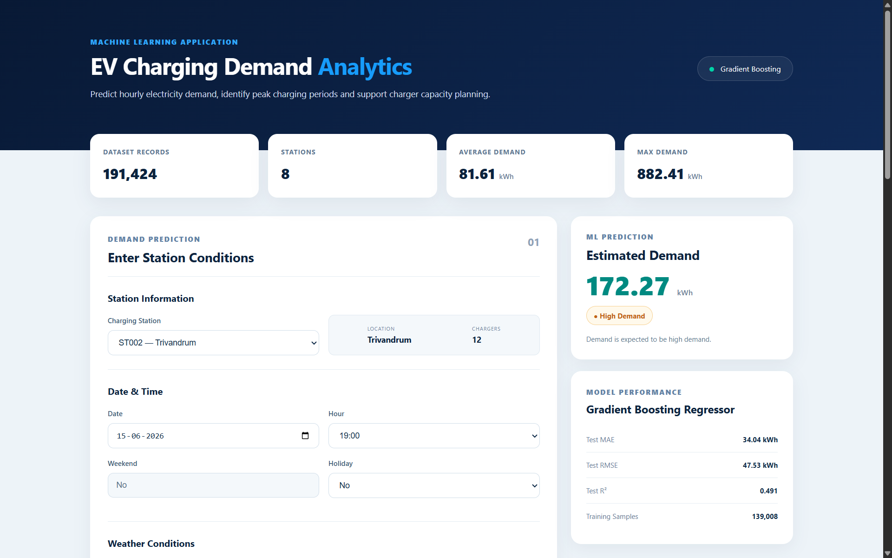
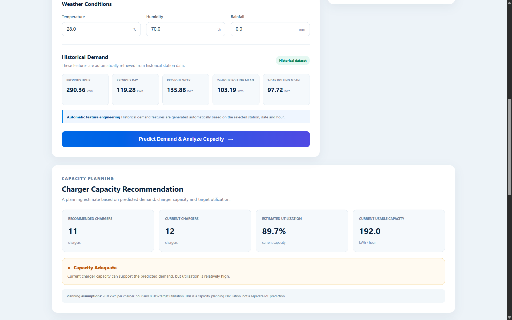
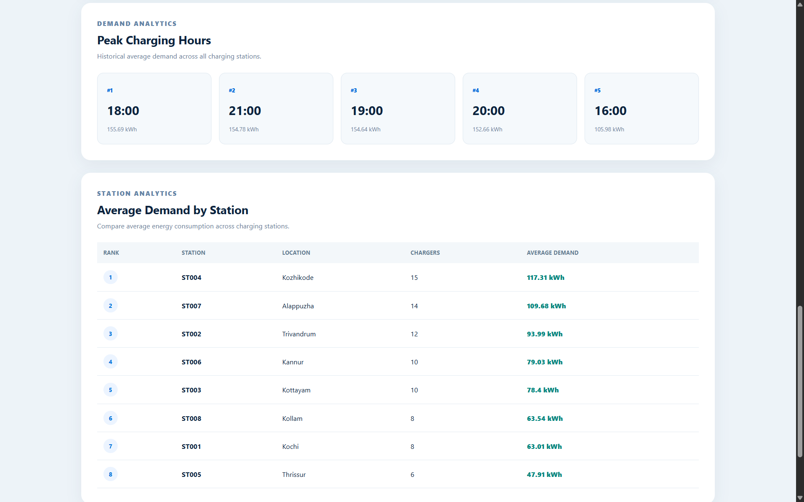
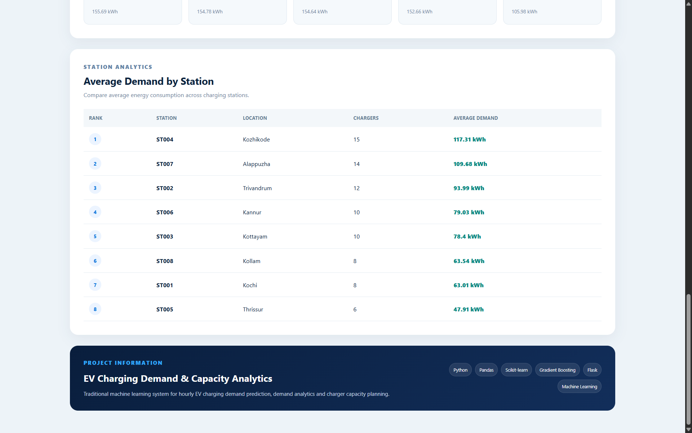

# EV Charging Demand & Capacity Analytics

A traditional Machine Learning application for predicting hourly EV charging demand and supporting charging-station capacity planning.

## Project Overview

Electric vehicle charging stations experience different demand patterns depending on:

- Time of day
- Day of week
- Weather conditions
- Historical charging demand
- Station characteristics

This project develops a Machine Learning system that predicts hourly energy demand and provides analytics for EV charging infrastructure planning.


## Application Screenshots

### Dashboard Overview



### Demand Prediction & Historical Features



### Charger Capacity Planning



### Station Analytics



## Key Features

- Hourly EV charging demand prediction
- Automatic historical feature engineering
- Peak charging-hour identification
- Charging-station demand comparison
- Demand classification
- Charger capacity planning
- Time-based train/validation/test split
- Gradient Boosting regression model
- Flask web application
- Interactive analytics dashboard

## Machine Learning Workflow

```text
Raw Dataset
     ↓
Data Cleaning
     ↓
Exploratory Data Analysis
     ↓
Feature Engineering
     ↓
Time-Based Data Splitting
     ↓
Model Training
     ↓
Model Comparison
     ↓
Gradient Boosting Selection
     ↓
Demand Prediction
     ↓
Analytics & Capacity Planning